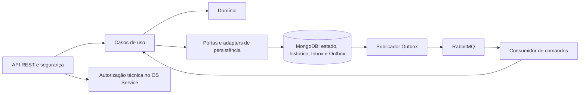

# tech-challenge-oficina-execution-service

[](https://sonarcloud.io/summary/new_code?id=AuroNet0_tech-challenge-oficina-execution-service)
[](https://sonarcloud.io/summary/new_code?id=AuroNet0_tech-challenge-oficina-execution-service)

O Execution Service mantém os diagnósticos técnicos, reparos e histórico de execução das ordens de serviço da oficina.
Recebe comandos do OS Service pelo RabbitMQ e disponibiliza trabalhos pendentes para início explícito por um mecânico autorizado via REST.
Persiste estado técnico, histórico, Inbox e Outbox em MongoDB transacional e publica os resultados pela Outbox.
Participa da Saga coordenada pelo OS Service, sem assumir sua orquestração.

## 2. Arquitetura do serviço



Pacote raiz: `com.oficina.execution`. Estrutura conferida em [src/main/java](src/main/java/com/oficina/execution):

| Pacote | Responsabilidade |
| --- | --- |
| `domain/model`, `domain/enums`, `domain/exception` | Agregados, itens, histórico, mensagens persistidas, estados e regras de domínio |
| `application/port/in`, `application/port/out` | Contratos de casos de uso, persistência, autorização, codec e broker |
| `application/usecase` | Operações técnicas, fila operacional, comandos e registro de eventos |
| `application/message`, `application/exception` | Envelopes, payloads e exceções de aplicação |
| `infrastructure/web` | Controllers, requests, responses e tratamento HTTP de erros |
| `infrastructure/persistence` | Documentos, repositórios, adapters e mappers MongoDB |
| `infrastructure/messaging` | Topologia RabbitMQ, consumidor, codec e publicador Outbox |
| `infrastructure/security`, `infrastructure/config` | JWT, autorização técnica, política HTTP e configuração transacional |

## 3. API e autenticação

Rotas conferidas nos [controllers](src/main/java/com/oficina/execution/infrastructure/web/controller) e em [SecurityConfig](src/main/java/com/oficina/execution/infrastructure/config/SecurityConfig.java). `osId` nas consultas é um parâmetro obrigatório.

| Método | Caminho | Papel (role) exigido |
| --- | --- | --- |
| GET | `/api/v1/diagnosticos/{id}` | `MECANICO` |
| GET | `/api/v1/diagnosticos?osId={uuid}` | `MECANICO` |
| POST | `/api/v1/diagnosticos/{id}/inicio` | `MECANICO` |
| POST | `/api/v1/diagnosticos/{id}/itens` | `MECANICO` |
| PATCH | `/api/v1/diagnosticos/{id}/observacoes` | `MECANICO` |
| POST | `/api/v1/diagnosticos/{id}/conclusao` | `MECANICO` |
| GET | `/api/v1/reparos/{id}` | `MECANICO` |
| GET | `/api/v1/reparos?osId={uuid}` | `MECANICO` |
| POST | `/api/v1/reparos/{id}/inicio` | `MECANICO` |
| PATCH | `/api/v1/reparos/{id}/observacoes` | `MECANICO` |
| POST | `/api/v1/reparos/{id}/conclusao` | `MECANICO` |
| GET | `/api/v1/execucoes/historico?osId={uuid}` | `MECANICO` |
| GET | `/api/v1/execucoes/fila` | `MECANICO` |
| GET | `/actuator/health` | Nenhum; acesso público |
| GET | `/actuator/health/liveness` | Nenhum; acesso público |
| GET | `/actuator/health/readiness` | Nenhum; acesso público |
| GET | `/internal/bootstrap` | Acesso negado pela política HTTP |

Além do papel, `@PreAuthorize` exige decisão atual de autorização para usuário, OS e capacidade: `DIAGNOSTIC_READ`, `DIAGNOSTIC_WRITE`, `DIAGNOSTIC_COMPLETE`, `REPAIR_READ`, `REPAIR_WRITE`, `REPAIR_COMPLETE` ou `HISTORY_READ`, conforme a operação. A fila filtra cada trabalho pela capacidade de leitura correspondente. O perfil `mtls` usa o adapter HTTPS para o OS configurado em `oficina.internal.os-uri`; a configuração de certificados depende do ambiente. Sem esse perfil, o adapter padrão retorna indisponibilidade (HTTP 503). Consulte [autorização técnica](docs/security/execution-authorization-8.3.3.md) e [fila operacional](docs/operational-queue-9.1.2.md).

A autenticação é Bearer JWT stateless. [AuthJwtDecoder](src/main/java/com/oficina/execution/infrastructure/security/AuthJwtDecoder.java) verifica assinatura RS256 com JWKS HTTPS, header `typ=JWT`, `kid` e seleção de uma única chave. Valida `iss` exatamente contra `EXECUTION_JWT_ISSUER`; `aud` deve ser uma lista contendo `EXECUTION_JWT_AUDIENCE`. Os valores de issuer e audience por ambiente não foram identificados no repositório. Também exige `sub` e `jti` como UUIDs canônicos e valida `iat`, `nbf` e `exp`, com duração máxima de 900 segundos e tolerância temporal zero.

O claim `roles` deve ser uma lista sem duplicatas, contendo somente `CLIENTE`, `ATENDENTE`, `MECANICO` e/ou `GERENTE`. A conversão acrescenta `ROLE_`; operações técnicas exigem `ROLE_MECANICO`. As demais rotas e métodos são negados por padrão.

Swagger/OpenAPI **não é publicado por política**: `springdoc.api-docs.enabled` e `springdoc.swagger-ui.enabled` são `false` em [application.yml](src/main/resources/application.yml), e as rotas de documentação não pertencem à allowlist de segurança. [BootstrapWebIntegrationTest](src/test/java/com/oficina/execution/infrastructure/web/BootstrapWebIntegrationTest.java) verifica sua negação.

### Coleção Postman

A [coleção do Execution Service](docs/postman/execution-collection.json) contém requisições de diagnósticos, reparos, fila, histórico, saúde e um caso negativo de permissão com o perfil Atendente.

1. Importe a coleção e o arquivo de ambiente no Postman.
2. Selecione o ambiente `Oficina - AWS`.
3. Preencha `baseUrl` com a URL do API Gateway, as credenciais dos perfis e `osId` com o identificador de uma OS aberta no `os-service`.
4. Gere os tokens com o Login da coleção do repositório `tech-challenge-oficina-auth`, em `docs/postman`, e preencha as variáveis de token do ambiente.

As operações técnicas exigem o perfil Mecânico e autorização na OS indicada por `osId`; diagnóstico e reparo só existem depois que a Saga os cria. As requisições de saúde são públicas, e o caso negativo usa o perfil Atendente para verificar a negação de acesso.

A coleção disponível usa variáveis para tokens, sem credenciais nem tokens versionados; este serviço não publica Swagger, sendo a coleção Postman a referência de uso da API.

## 4. Dados

O serviço tem banco próprio **MongoDB (NoSQL)**, com nome padrão `oficina_execution`, configurável por `MONGO_DATABASE`. O [Compose](compose.yaml) provisiona sua instância e volume `mongodb-data`. A URI em [application.yml](src/main/resources/application.yml) usa `spring.mongodb.uri`, `replicaSet=rs0` e `directConnection=true`.

O MongoDB local usa a imagem `mongo:8.0` e replica set de um membro. [MongoTransactionConfig](src/main/java/com/oficina/execution/infrastructure/config/MongoTransactionConfig.java) fornece `MongoTransactionManager`; os casos de uso de escrita usam `@Transactional`. Diagnósticos e reparos possuem `@Version` para concorrência otimista.

| Coleção | Conteúdo |
| --- | --- |
| `diagnostics` | Diagnósticos e itens embutidos |
| `work_orders` | Reparos |
| `execution_history` | Histórico técnico |
| `inbox_messages` | Comandos recebidos e situação de processamento |
| `outbox_events` | Eventos a publicar, tentativas, sequência e lease |

Os nomes são definidos nos [documentos MongoDB](src/main/java/com/oficina/execution/infrastructure/persistence/document). Índices são criados pelas anotações com `spring.data.mongodb.auto-index-creation=true`. Migrações versionadas ou ferramenta de migração: **não identificado**.

## 5. Mensageria

Contratos em [docs/messaging.md](docs/messaging.md), conferidos em [RabbitMessagingConfig](src/main/java/com/oficina/execution/infrastructure/messaging/RabbitMessagingConfig.java), [CommandHandler](src/main/java/com/oficina/execution/application/usecase/CommandHandler.java) e [RabbitMessageBrokerAdapter](src/main/java/com/oficina/execution/infrastructure/messaging/RabbitMessageBrokerAdapter.java).

| Exchange topic durável | Uso |
| --- | --- |
| `oficina.commands` | Comandos recebidos do OS Service |
| `oficina.events` | Eventos publicados pelo Execution |
| `execution.commands.retry` | Encaminhamento de falhas transitórias |
| `execution.commands.dlx` | Encaminhamento de mensagens rejeitadas à DLQ |

| Fila durável | Routing key consumida |
| --- | --- |
| `execution.diagnostic.start` | `diagnostic.start.v1` |
| `execution.repair.start` | `repair.start.v1` |
| `execution.repair.cancel` | `repair.cancel.v1` |

Cada fila possui uma auxiliar com sufixo `.retry`, vinculada a `execution.commands.retry`. Seu TTL devolve a mensagem a `oficina.commands`. `execution.commands.dlq` recebe o binding `#` de `execution.commands.dlx`. As filas principais não têm argumentos de DLX; o consumidor transfere explicitamente para retry/DLQ com publicação persistente, `mandatory` e confirmação do broker antes de liberar a entrega original.

Por padrão, comandos transitórios aguardam 5 segundos e têm limite de 5 processamentos, incluindo o inicial (`COMMAND_RETRY_DELAY`, `COMMAND_MAX_DELIVERIES`). Erros permanentes seguem diretamente para DLQ. Falha ao confirmar a transferência preserva a entrega para reenvio. Não há retorno automático da DLQ aos comandos.

| Eventos publicados em `oficina.events` | Payload |
| --- | --- |
| `diagnostic.started.v1`, `repair.started.v1` | Objeto vazio |
| `diagnostic.completed.v1` | Itens do diagnóstico |
| `repair.completed.v1` | `repairId` |
| `diagnostic.failed.v1`, `repair.failed.v1` | `reason` |
| `repair.cancelled.v1` | Objeto vazio |
| `repair.cancellation-failed.v1` | `reason` |

A Inbox deduplica por `eventId`. O processamento de comandos persiste Inbox, alterações técnicas, histórico e eventuais eventos de Outbox na mesma transação. Inícios e conclusões REST gravam estado, histórico e Outbox atomicamente. O [publicador Outbox](src/main/java/com/oficina/execution/infrastructure/messaging/OutboxPublisher.java) envia depois do commit, preservando o `eventId` nas tentativas; a entrega é **at-least-once**.

A Outbox aplica lease e backoff exponencial, com padrões de 5 tentativas, atraso inicial de 10 segundos e máximo de 5 minutos. Eventos `FAILED` bloqueiam os seguintes da mesma OS; não há endpoint de redrive. O consumo RabbitMQ não exige JWT humano.

## 6. Papel na Saga e compensação

O Execution é **participante**. O orquestrador é o [OS Service](https://github.com/AuroNet0/tech-challenge-oficina-os-service), conforme os contratos registrados em [mensageria](docs/messaging.md).

`diagnostic.start.v1` cria diagnóstico `PENDING`. `repair.start.v1` exige diagnóstico concluído e consistente com a Saga e disponibiliza reparo `PENDING`. Esses comandos não iniciam automaticamente o trabalho físico: o mecânico autorizado chama `/inicio`, que passa o agregado para `IN_PROGRESS` e registra `diagnostic.started.v1` ou `repair.started.v1`. Conclusões publicam os eventos `completed`; falhas podem produzir os eventos `failed` pelos serviços internos e pelo tratamento de erros de domínio dos comandos.

| Estado do reparo ao consumir `repair.cancel.v1` | Resultado |
| --- | --- |
| `PENDING` | Passa para `CANCELLED` e publica `repair.cancelled.v1` |
| `CANCELLED` | Confirma o cancelamento com `repair.cancelled.v1` |
| `IN_PROGRESS` ou `FAILED` | Preserva o estado e publica `repair.cancellation-failed.v1`; exige intervenção manual |
| `COMPLETED` | Preserva a conclusão e publica `repair.cancellation-failed.v1`; o reparo físico já realizado não é desfeito |
| Inexistente | Publica `repair.cancellation-failed.v1` e rejeita o comando na Inbox |

A compensação não desfaz automaticamente trabalho físico. A validação de `sagaId` impede aplicar um comando a agregado de outra Saga.

## 7. Execução local e testes

Pré-requisitos: Java 21, Docker com containers Linux e Docker Compose. O repositório inclui Maven Wrapper para Unix e Windows.

Configure as variáveis no ambiente ou em arquivo `.env` local, sem versionar credenciais:

| Variáveis | Uso |
| --- | --- |
| `EXECUTION_JWT_ISSUER`, `EXECUTION_JWT_AUDIENCE`, `EXECUTION_JWT_JWKS_URI` | Obrigatórias no Compose; JWKS deve usar HTTPS |
| `MONGO_HOST`, `MONGO_PORT`, `MONGO_DATABASE` | Endereço e banco; no Compose a aplicação usa `mongodb:27017` |
| `MONGO_USERNAME`, `MONGO_PASSWORD`, `MONGO_AUTH_DATABASE` | Autenticação MongoDB; Compose fixa `admin` como banco de autenticação |
| `RABBITMQ_HOST`, `RABBITMQ_PORT`, `RABBITMQ_USERNAME`, `RABBITMQ_PASSWORD`, `RABBITMQ_VHOST` | Conexão ao broker |
| `EXECUTION_RABBITMQ_PORT`, `EXECUTION_RABBITMQ_MANAGEMENT_PORT` | Portas do broker opcional; padrões 5673 e 15673 |

Suba aplicação, MongoDB e broker opcional:

```bash
docker compose --profile local-broker up --build -d
```

Com broker externo configurado, use `docker compose up --build -d`. A aplicação fica em `http://localhost:8081`, mapeada à porta 8080 do container. O Compose usa `host.docker.internal:5673` como endereço padrão do broker; os serviços integrados precisam compartilhar broker e vhost.

Para executar a aplicação no host, configure as variáveis JWT e a conexão ao broker (porta 5673 se usar o broker opcional), inicie o MongoDB e execute:

```bash
docker compose up -d --wait mongodb
./mvnw spring-boot:run
```

Nesse modo a porta HTTP padrão é 8080. O Compose não configura o perfil `mtls` nem seu canal de autorização; iniciar a aplicação não torna as operações técnicas autorizadas.

Execute a suíte completa:

```bash
./mvnw clean verify
```

No PowerShell, use `.\mvnw.cmd clean verify` ou `.\mvnw.cmd spring-boot:run`. **Docker precisa estar disponível para Testcontainers**: os testes de integração usam MongoDB 8.0 e RabbitMQ 4 reais. A suíte inclui domínio, casos de uso, persistência transacional, concorrência, HTTP/JWT, mensageria, Inbox/Outbox e retry/DLQ. O relatório é gerado em `target/site/jacoco/index.html`; esse arquivo gerado não é um link versionado.

## 8. Qualidade e cobertura

O [pom.xml](pom.xml) executa relatório e gate JaCoCo na fase `verify`: elemento `BUNDLE`, contador `LINE`, razão `COVEREDRATIO`, mínimo **0,80 (80%)**. A única exclusão configurada é `ExecutionApplication.class`.

Cobertura medida pelo SonarCloud na análise de **13/11/2026: 89,4%**. Projeto: [Execution no SonarCloud](https://sonarcloud.io/summary/new_code?id=AuroNet0_tech-challenge-oficina-execution-service).

## 9. CI/CD

O [workflow atual](.github/workflows/ci.yml) roda em pull requests e pushes para `main` e `homolog`, além de execução manual. Detalhes em [docs/ci.md](docs/ci.md).

O job `verify` executa testes dos scripts CI e [scripts/ci/verify.py](scripts/ci/verify.py): varredura básica de segredos, Java 21, `clean verify`, validação dos relatórios sem falhas/erros/testes ignorados e gate JaCoCo LINE de 80%. Constrói a imagem `linux/amd64`, verifica usuário não root, entrypoint, healthcheck e SIGTERM. O teste de runtime sobe MongoDB autenticado em replica set e RabbitMQ, verifica os três endpoints de health e a parada por SIGTERM; remove os recursos temporários ao final.

A análise SonarCloud usa o XML JaCoCo. A espera pelo **Quality Gate bloqueante ocorre somente em push na `main`** (`sonar.qualitygate.wait=true`); a análise também é executada nos demais gatilhos, e falhas do scanner ou ausência de token reprovam o job. Relatórios JSON sanitizados são coletados mesmo em falha e publicados com retenção de sete dias.

O job `deploy` depende de `verify` e roda **somente em push na `main`**. Assume a role AWS por OIDC e consulta EKS/ECR no preflight: cluster ou repositório ausentes resultam em skip, permitindo o ambiente desligado; outros erros reprovam o job. Com o ambiente presente, usa a revisão `github.sha`, reutiliza sua imagem no ECR quando existente ou faz build/push com tag do SHA, sem sobrescrever deliberadamente a tag existente. A política de imutabilidade do ECR não é configurada neste workflow.

O deploy resolve o digest, aplica `kubectl set image` ao Deployment/container e aguarda `kubectl rollout status` por até 300 segundos. Em falha, coleta descrição e logs e reprova; não há rollback automático nesse job.

| Secret/variável | Origem e finalidade |
| --- | --- |
| `SONAR_TOKEN` | Secret do GitHub Actions para a análise SonarCloud |
| `AWS_ROLE_ARN` | Variável do GitHub Actions (`vars.AWS_ROLE_ARN`) para assumir a role de deploy |
| `GITHUB_TOKEN` | Token fornecido pelo GitHub Actions e repassado ao scanner |

## 10. Implantação

O workflow configura deploy no EKS com estes valores; sua existência e disponibilidade no ambiente não são comprovadas pela leitura do arquivo:

| Item | Valor no repositório |
| --- | --- |
| Região AWS | `us-east-1` |
| Cluster EKS | `tc-oficina-p4-demo-a` |
| Namespace | `tc-oficina-p4-demo-a` |
| Deployment | `execution-service` |
| Container | `execution-service` |
| Repositório ECR | `tc-oficina-p4-demo-a-execution` |
| Referência implantada | Registro da conta AWS resolvida em runtime, repositório ECR e digest `sha256` |
| Porta do container | `8080`, declarada no Dockerfile |
| Health | `/actuator/health` |
| Liveness | `/actuator/health/liveness` |
| Readiness | `/actuator/health/readiness` |

A pasta `k8s/` contém [k8s/execution-service.yaml](k8s/execution-service.yaml), com manifestos de referência (ServiceAccount, ConfigMap, Service e Deployment) que espelham o que o stack `platform` do repositório `tech-challenge-oficina-k8s-infra` aplica no EKS. Os valores entre `<...>` (issuer, audience, JWKS, conta AWS e tag da imagem) são fornecidos pela infraestrutura em cada ambiente; segredos de TLS, MongoDB e RabbitMQ são referenciados por nome e não ficam no repositório. O arquivo não é aplicado diretamente por este repositório: o Deploy da infraestrutura provisiona e aplica os recursos no cluster, enquanto o job `deploy` do `ci.yml` apenas atualiza a imagem do Deployment com `kubectl set image`.

O [Dockerfile](Dockerfile) usa Java 21, usuário `app` e healthcheck de readiness na porta 8080. A configuração de health inclui MongoDB na readiness e apenas `livenessState` na liveness; RabbitMQ não integra o health. Os GETs de probes são públicos e não expõem detalhes de componentes.

Repositório de infraestrutura: [tech-challenge-oficina-k8s-infra](https://github.com/AuroNet0/tech-challenge-oficina-k8s-infra). O Deployment é criado pelo Deploy desse repositório; o CI deste serviço atualiza a imagem do Deployment existente.

## 11. Estrutura do repositório

| Pasta/arquivo | Conteúdo relevante |
| --- | --- |
| [src/main](src/main) | Aplicação Java e configuração Spring |
| [src/test](src/test) | Testes unitários, integração e fixtures JWT |
| [docs](docs) | Mensageria, CI, fila operacional e autorização |
| `docs/postman` | Coleção Postman do serviço e ambiente |
| `k8s` | Manifestos Kubernetes de referência do serviço |
| [docker](docker) | `mongo-entrypoint.sh` gera a chave interna e inicia `mongod` com `rs0`; `mongo-healthcheck.js` inicializa o replica set quando necessário e verifica o primário |
| [scripts/ci](scripts/ci) | Verificador, testes dos scripts, validador YAML e Compose isolado de runtime |
| [.github/workflows](.github/workflows) | Workflow de verificação e deploy |
| [.mvn](.mvn) | Configuração do Maven Wrapper |
| [compose.yaml](compose.yaml) | Aplicação, MongoDB e perfil opcional RabbitMQ |

Os dois arquivos de `docker/` são montados pelo Compose local e por `scripts/ci/compose.yaml`. O harness de integração do Billing (`integration/9.1.4`) também monta essa pasta; os testes Java daqui usam `MongoDBContainer`.
